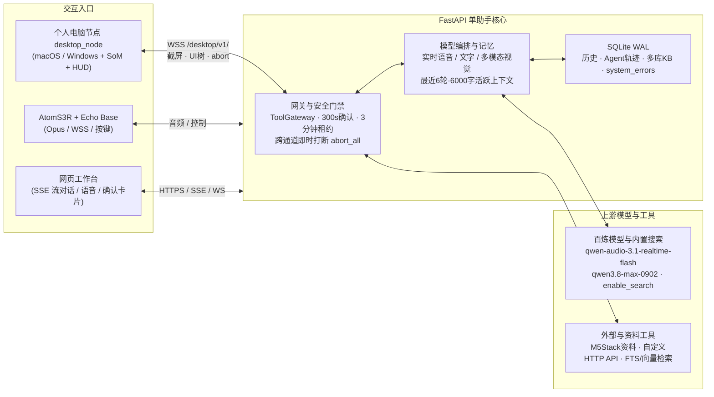

<div align="center">

# 小圆 · Xiaoyuan

**个人自用的硬件语音与跨平台桌面 Agent 工作台**

集 **AtomS3R 硬件语音**、**网页工作台**、**多独立个人知识库** 与 **macOS / Windows 电脑操控** 于一体 ——<br />
听懂意图、真实执行、随时喊停，保持单助手架构的简单、直接与安全。

[](pyproject.toml)
[](backend/app/main.py)
[](backend/app/app.html)
[](backend/app/history_store.py)
[](desktop_node/client.py)
[](firmware/xiaozhi-esp32)

[文档总入口](AGENTS.md) · [当前状态快照](agent/START.md) · [系统架构](agent/docs/architecture.md) · [产品需求](agent/docs/prd.md) · [更新与实测记录](agent/docs/progress.md)

</div>

---

## 核心特性

<table>
  <tr>
    <td width="50%" valign="top">
      <h3>🎙️ 全双工实时语音 & 内置联网</h3>
      <ul>
        <li><strong>实时语音主线</strong>：接入百炼 <code>qwen-audio-3.1-realtime-flash</code>，支持 <code>fun-asr</code> 实时转写与 <code>voice-enrollment</code> 复刻音色，兼顾 OpenAI Realtime 与分模型 Pipeline。</li>
        <li><strong>原生联网搜索合并</strong>：启用百炼内置 <code>enable_search</code> 统一承接常规联网与天气查询（无需单独配天气源或默认城市，缺城市时主动追问）。</li>
        <li><strong>硬件 + 网页双入口</strong>：支持 AtomS3R 语音唤醒（“塔菲”）、正面按键控制，以及网页沉浸式语音与 SSE 流式文字对话。</li>
      </ul>
    </td>
    <td width="50%" valign="top">
      <h3>🖥️ 跨平台个人电脑操控 & 即时打断</h3>
      <ul>
        <li><strong>SoM 视觉 + 系统控件树</strong>：在 macOS（Swift <code>AXUIElement</code> / <code>CoreGraphics</code>）与 Windows（.NET <code>UIA</code>）自动绘制高亮编号框与控件定位，直连多模态视觉模型精确操控。</li>
        <li><strong>交互确认 + 3 分钟租约</strong>：打开应用、键鼠操控、写剪贴板与终端命令均受确认卡片 / 语音“确认”门禁保护；支持 3 分钟免重复弹窗租约与连续 3 轮报错熔断。</li>
        <li><strong>语音 / 网页随时喊停</strong>：操作桌面时说“停止 / 别动了 / 住手 / 关闭”或点击停止，立即跨会话取消任务、撤回租约并隐藏桌端穿透悬浮 HUD。</li>
      </ul>
    </td>
  </tr>
  <tr>
    <td width="50%" valign="top">
      <h3>📚 个人知识库 & Agent 执行轨迹</h3>
      <ul>
        <li><strong>多独立知识库隔离</strong>：按助手选中范围在 SQLite FTS 与向量检索前执行服务端 <code>library_id</code> 硬过滤，不跨库串联。</li>
        <li><strong>左树右详轨迹查看器</strong>：网页「记录」按会话 1:1 聚合「对话历史」，展开详情可逐轮回看模型思考/输入输出、工具耗时与等待耗时（<code>first_response_ms</code>）及 Token 明细。</li>
        <li><strong>四维可观测面板</strong>：拆分为「对话历史 / 知识库（纯检索）/ 工具调用 / 异常（脱敏系统错误日志）」四页签。</li>
      </ul>
    </td>
    <td width="50%" valign="top">
      <h3>🛡️ 单助手安全与极简设计</h3>
      <ul>
        <li><strong>单用户极简工作台</strong>：沿用 Codex 灰阶明暗主题与暖琥珀金强调色，模型配置收敛为两张主卡片 + 3 项高级开关。</li>
        <li><strong>双重凭据硬拦截</strong>：服务端网关与本地 <code>desktop_node</code> 双重拦截 <code>.env</code>、<code>.ssh</code>、私钥与 Keychains 读取。</li>
        <li><strong>公网与隐私边界</strong>：公网访问自动隐藏桌面节点配对令牌与截屏预览，仅展示只读在线卡片；完整文字历史持久化，不长期保存聊天录音。</li>
      </ul>
    </td>
  </tr>
</table>

---

## 系统架构



---

## 快速上手

### 1. 获取源码与安装依赖

```sh
git clone https://gitee.com/ryan406/xiaoyuan.git
cd xiaoyuan
```

<details>
<summary>安装 Python 环境（macOS / Windows）</summary>

**macOS / Linux：**
```sh
python3 -m venv .venv
.venv/bin/pip install -r requirements.txt
```

**Windows (PowerShell)：**
```powershell
python -m venv .venv
.\.venv\Scripts\python.exe -m pip install -r requirements.txt
```

</details>

### 2. 启动管理端与设备网关

**macOS / Linux：**
```sh
# 同时启动管理后台 (8000) 与硬件设备网关 (8003)
.venv/bin/python -m backend.run_devices

# 仅启动网页管理端与 API
.venv/bin/python -m uvicorn backend.app.main:app --host 127.0.0.1 --port 8000
```

**Windows (PowerShell)：**
```powershell
.\start.ps1 -Devices
```

### 3. 连接个人电脑节点（`desktop_node`）

在本机「设置 → 设备 → 电脑」复制对应系统的连接命令（公网模式已默认隐藏真实令牌，请从本机或服务端配置获取 `<gateway_token>`）：

```sh
# macOS（首次运行请在 系统设置 → 隐私与安全性 开启 辅助功能 与 录屏与系统录音）
.venv/bin/python -m desktop_node --server "wss://<your-domain>/xiaoyuan/desktop/v1/" --token "<gateway_token>"
```

```powershell
# Windows
.\.venv\Scripts\python.exe -m desktop_node --server "wss://<your-domain>/xiaoyuan/desktop/v1/" --token "<gateway_token>"
```

> 云端部署脚本与 systemd / Caddy 模板位于 [deploy/](deploy)，发布与备份流程详见 [操作手册](agent/docs/operations.md)。

### 4. 开发校验（推荐改动后按需运行）

```sh
# 增量代码与类型检查（ruff + pyright）
.venv/bin/python scripts/lint_incremental.py

# 核心回归（桌面操控与即时打断 / 实时语音 / 多库隔离 / 轨迹审计）
.venv/bin/pytest tests/test_desktop_bridge.py tests/test_realtime_failures.py tests/test_voice_compat.py tests/test_gateway_trace.py tests/test_personal_kb_isolation.py -v

# 前端 JS 语法检查
node --check backend/app/app.js
```

---

## 目录结构

```text
xiaoyuan/
├── AGENTS.md                 # 唯一工作约定、验证范围与协作边界
├── README.md                 # 项目总览与快速入口
├── backend/                  # FastAPI 服务端、模型适配、网关与原生前端 (app.html/app.js/app.css)
│   ├── run_devices.py        # 单进程管理端 + 设备网关入口
│   └── app/                  # 实时会话、工具网关、电脑操控中心、KB、轨迹审计与历史存储
├── desktop_node/             # macOS / Windows 跨平台桌面节点 (SoM 标注、控件树、穿透 HUD、RPC 客户端)
├── deploy/                   # Caddy 路由与脱敏日志、systemd、原子发布 (release_from_git.sh) 与备份脚本
├── firmware/                 # AtomS3R + Echo Base 固件工程与既有备份
├── scripts/                  # 增量 Lint 与知识库迁移脚本
├── tests/                    # 自动化回归与浏览器/语音验证套件
└── agent/                    # 项目规范、现状快照、PRD、架构、决策与实跑证据
```

---

## 文档导航

> 本页仅作项目概览与快速入口，不维护运行状态或历史测试列表；详细规范与实测边界请按顺序查阅：

| 文档 | 用途说明 |
| --- | --- |
| [AGENTS.md](AGENTS.md) | 唯一总入口：工作原则、验证选择、三端协同与安全红线 |
| [agent/START.md](agent/START.md) | 当前代码基线、已生效并实测的能力、待实机验证与暂缓事项 |
| [agent/docs/prd.md](agent/docs/prd.md) | 产品范围、交互规则（R00–R13）与界面行为规格 |
| [agent/docs/architecture.md](agent/docs/architecture.md) | 实时语音、原生联网、桌面操控与跨通道打断架构设计 |
| [agent/docs/decisions.md](agent/docs/decisions.md) | 关键产品决策与历史取代关系（D36–D47） |
| [agent/docs/roadmap.md](agent/docs/roadmap.md) | 当前真实待办与实施约束 |
| [agent/docs/progress.md](agent/docs/progress.md) | 按日期留存的真实云端、设备与自动化测试证据索引 |
| [agent/docs/operations.md](agent/docs/operations.md) | 本机启动、云端发布、Caddy 配置与数据备份恢复手册 |
| [agent/docs/handoff.md](agent/docs/handoff.md) | 新电脑与三端开发接手说明 |
| [agent/code/structure.md](agent/code/structure.md) | 后端、桌端、固件与运行文件位置地图 |
